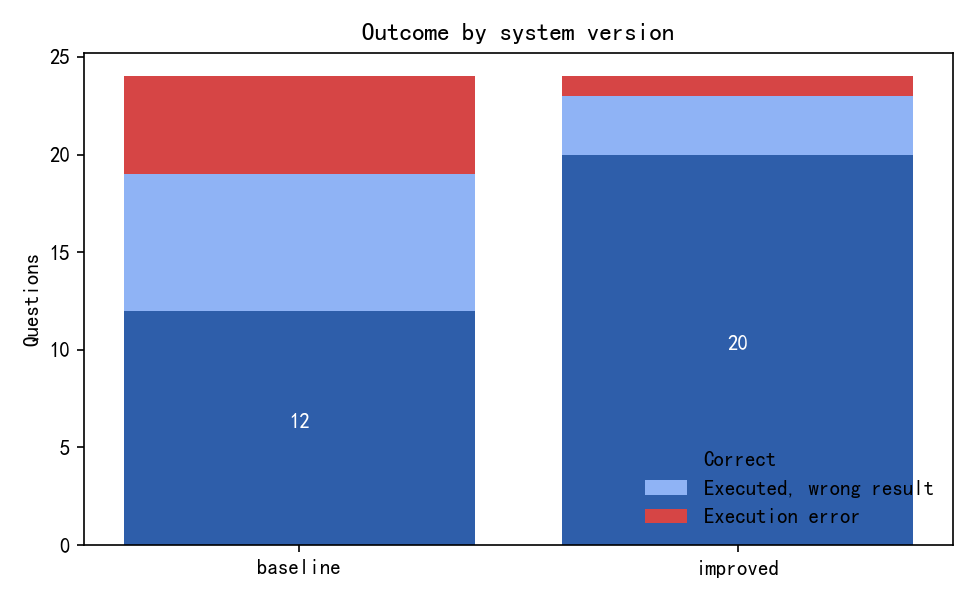
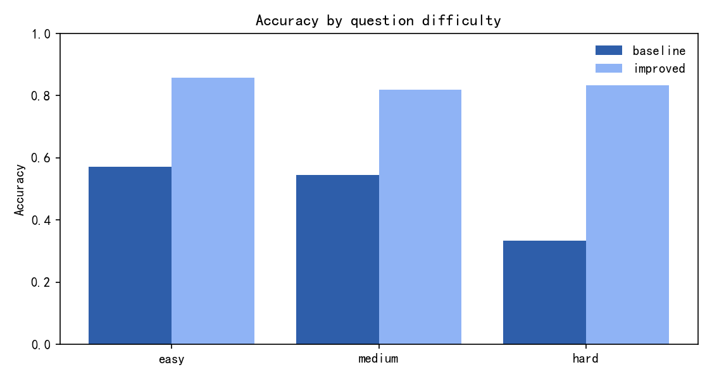
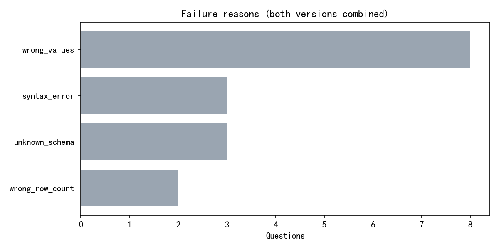

# AI 问数产品质量分析与迭代评测（Text-to-SQL Evaluation）

> **重要声明：本项目没有调用任何真实大语言模型。** 两个待评测版本（`baseline` / `improved`）的候选 SQL
> 由 `src/tsqleval/candidates.py` 对标准答案 SQL 施加**确定性错误注入**生成，用于验证评测框架本身
> （执行安全、结果比较、错误分类、指标统计、Bootstrap）。因此下文的"准确率"描述的是这两组候选 SQL，
> **不是任何模型的 benchmark 结果**。接入真实模型时只需替换候选 SQL 的来源，评测逻辑不变。

## 1. 评测对象

| 项 | 说明 |
| --- | --- |
| 数据库 | SQLite，4 张表：users / products / orders / order_items |
| 数据规模 | 3,000 用户、400 商品、8,002 订单、16,029 订单行 |
| 测试集 | 24 道自然语言问题，全部配有可执行的 gold SQL |
| 难度分布 | easy=7, medium=11, hard=6 |
| 版本 | baseline（错误注入率 45%）、improved（20%） |

## 2. 评测流程

1. **加载并校验 gold SQL**：每道题的 gold SQL 先实际执行，失败即中止（不允许"标准答案跑不通"）。
2. **执行候选 SQL**：统一经过只读执行守卫（见 §5），记录耗时、行数、错误类型。
3. **结果比较**：列数 → 行数 → 值（NULL 只等于 NULL、浮点容差 1e-6、按 gold 是否 `ORDER BY` 决定比顺序还是比多重集）。
4. **错误分类**：语法错误、表/列不存在、超时、被安全策略拦截、空结果、行数不符、值不符、列数不符、顺序不符。
5. **指标与不确定性**：执行率、正确率、按难度拆解、失败原因分布、配对 Bootstrap 的版本差异置信区间。

## 3. 总体结果

| version | questions | executed | execution_rate | correct | accuracy | latency_p50_ms | latency_p95_ms |
| --- | --- | --- | --- | --- | --- | --- | --- |
| baseline | 24 | 19 | 79.17 | 12 | 50.00 | 3.462 | 31.000 |
| improved | 24 | 23 | 95.83 | 20 | 83.33 | 5.634 | 38.502 |

- **执行率**：SQL 能成功跑完的比例（语法/表列/超时都会拉低）。
- **正确率**：结果与 gold 完全一致的比例；**同时**要求可执行。
- **accuracy_given_executed**：只在执行成功的查询里看正确率，用于区分"写不出来"和"写错语义"。

| version | accuracy_given_executed |
| --- | --- |
| baseline | 63.16% |
| improved | 86.96% |

## 4. 按难度拆解

| version | difficulty | questions | executed | correct | accuracy | execution_rate |
| --- | --- | --- | --- | --- | --- | --- |
| baseline | easy | 7 | 6 | 4 | 57.14 | 85.71 |
| baseline | medium | 11 | 10 | 6 | 54.55 | 90.91 |
| baseline | hard | 6 | 3 | 2 | 33.33 | 50.00 |
| improved | easy | 7 | 7 | 6 | 85.71 | 100.00 |
| improved | medium | 11 | 10 | 9 | 81.82 | 90.91 |
| improved | hard | 6 | 6 | 5 | 83.33 | 100.00 |

## 5. 执行安全（只读守卫）

| 机制 | 实现 | 说明 |
| --- | --- | --- |
| 只读文件 | `file:...?mode=ro` | 即使写入语句绕过检查也无法落盘 |
| Authorizer | 只允许 SELECT / READ / FUNCTION / RECURSIVE | DDL、DML、ATTACH、PRAGMA 全部拒绝 |
| 危险函数 | 按函数名拒绝 `load_extension` / `readfile` / `writefile` 等 | 不依赖字符串黑名单 |
| 单语句 | 引号/注释感知的分号切分 | 拒绝堆叠语句 |
| 超时 | `set_progress_handler` + 截止时间 | 超时中断并归类为 timeout |
| 行数上限 | 外层 `LIMIT n+1` 包裹并标记截断 | 防止结果集过大拖垮评测 |

验证结果：`tests/test_guard.py` 覆盖写操作、DDL、ATTACH、PRAGMA、多语句、危险函数、超时与行数上限，
全部按预期被拦截。守卫参数：超时 5.0 秒、行数上限 5,000。

## 6. 失败原因分布

| reason | count | share |
| --- | --- | --- |
| wrong_values | 8 | 16.67 |
| syntax_error | 3 | 6.25 |
| unknown_schema | 3 | 6.25 |
| wrong_row_count | 2 | 4.17 |

### 6.1 典型失败案例

| version | question_id | reason | question | sql |
| --- | --- | --- | --- | --- |
| baseline | q01 | wrong_values | 2024 年 1 月一共有多少笔订单？ | SELECT COUNT(*) AS order_count FROM orders |
| baseline | q07 | syntax_error | 每个州有多少用户？请按用户数从多到少排序。 | SELECT state, COUNT(*) AS user_count FROM users GROUP BY |
| baseline | q10 | wrong_row_count | 下单次数最多的前 10 名用户是谁？请给出用户 ID 和订单数。 | SELECT user_id, COUNT(*) AS order_count FROM orders ORDER BY order_count DESC, user_id LIMIT 10 |
| baseline | q11 | unknown_schema | 状态为已送达（delivered）的订单，其商品销售额合计是多少？ | SELECT ROUND(SUM(i.quantity * i.unit_price), 2) AS delivered_gmv FROM orders o JOIN order_items i ON i.order_id = o.orde… |
| improved | q03 | wrong_values | 一共有多少个不同的商品品类？ | SELECT COUNT(category) AS category_count FROM products |
| improved | q10 | wrong_values | 下单次数最多的前 10 名用户是谁？请给出用户 ID 和订单数。 | SELECT user_id, COUNT(*) AS order_count FROM orders GROUP BY user_id ORDER BY order_count ASC, user_id LIMIT 10 |
| improved | q14 | wrong_values | 每个品类的销售额及其占总销售额的百分比是多少？请按销售额降序。 | WITH cat AS (SELECT p.category, COUNT(i.quantity * i.unit_price) AS gmv FROM order_items i JOIN products p ON p.product_… |
| improved | q19 | unknown_schema | 平均每笔订单包含多少件商品？ | SELECT ROUND(1.0 * SUM(missing_column) / COUNT(DISTINCT order_id), 2) AS items_per_order FROM order_items |

## 7. 版本差异（配对 Bootstrap）

| 指标 | 数值 |
| --- | --- |
| 正确率差异（improved − baseline） | 33.33 pp |
| 95% CI | [12.50, 54.17] pp |
| Bootstrap p 值 | 0.0030 |

> 以题目为单位做配对重采样（同一批题在两个版本上成对比较），区间不跨 0 说明 improved 的改进不是抽样波动。

## 8. 结论

1. 评测框架能够**真实执行** SQL、区分"可执行"与"结果正确"，并对 NULL、浮点误差、行序、行数、列数
   做出明确定义的比较。
2. 错误注入率更低的 improved 版本在执行率与正确率上均优于 baseline，差异的 Bootstrap 区间见 §7。
3. 只读守卫在数据库文件层、语句层、函数层三重限制，测试覆盖了常见绕过路径。
4. 本项目的候选 SQL 是**模拟生成**的；如果换成真实模型，应记录模型名称、温度、提示词版本、调用时间与费用。

## 9. 局限与后续

1. **没有真实 LLM 调用**：所有分数只对当前候选集合有意义，不能对外宣称模型的 Text-to-SQL 能力。
2. **测试集规模小**（24 题）：适合验证框架，不足以评估模型泛化。
3. **结果比较假设答案唯一**：开放性问题（如"列出所有商品"）未纳入；列名不参与比较，只比较列数。
4. **错误分类是启发式**：从异常信息与结果差异推断，不能定位到具体 SQL 子句。
5. **后续**：接入 DeepSeek API（Key 通过环境变量注入，禁止写入仓库）、扩大测试集、增加 SQL 语法树级诊断、
   引入执行计划成本与多轮澄清评测。
